<div align="center">

<a href="https://mesix971.github.io/mods-claude/"></a>

### Deux mods pour [Claude Code](https://claude.com/claude-code) : **clawd**, le compagnon en pixel art qui vit au-dessus de ton prompt, et **atelier**, le bandeau du dev Android.

**[▶ Le film de présentation](https://mesix971.github.io/mods-claude/)** · [Installer](#installation) · [Clawd](#clawd) · [atelier](#atelier) · [In English](#in-english)

  

</div>

Projet perso, fan-made et non officiel, sans lien avec Anthropic.

## In English

Two mods for [Claude Code](https://claude.com/claude-code), in the CLI and the desktop app's Code tab:

- **clawd**: a tiny pixel-art Claude who lives above your prompt and silently acts out your session, in 73 animated scenes with no text. He carries boxes while Claude works, and sometimes opens one. He celebrates passing builds and sulks under a rain cloud when they break. Each subagent arrives as a mini-Clawd in its model's color, hands its work back, then leaves in one of five ways. He sweats as the context fills, wears an autopilot visor in auto or bypass mode, and levels up as you work together. With atelier loaded, he also plays gags across its band: he steals the loading orb and makes the pills pop like popcorn, then always puts everything back.
- **atelier**: a project band for Android developers:
  - APK and phone versions, with Install and Launch buttons;
  - git status, with Commit, Push and Pull buttons;
  - quota gauges with a pace projection, the live API-price cost and model advice;
  - task and subagent pills;
  - guardrails for destructive commands, secrets in commits and pushes you didn't ask for.

The mods speak French. Install them with the commands below, then open a new session.

## Installation

```bash
claude plugin marketplace add mesix971/mods-claude
claude plugin install clawd@mods-claude
claude plugin install atelier@mods-claude
```

Ouvre ensuite une nouvelle session : Clawd te fait coucou. Tu ne veux que
Clawd ? N'installe que lui. Il te faut une version récente de Claude Code,
car les mods utilisent les hooks de fonction. Toute l'animation se voit dans
l'onglet Code de l'app de bureau ; dans le terminal, Clawd est un logo en
blocs, avec un emoji pour ce qu'il fait.

Pour les mettre à jour :

```bash
claude plugin update clawd@mods-claude
claude plugin update atelier@mods-claude
```

<details>
<summary>Sans la marketplace (pour développer les mods)</summary>

Clone le dépôt, puis indique les dossiers des mods dans le bloc `env` de
`~/.claude/settings.json` :

```json
{
  "env": {
    "CLAUDE_CODE_PLUGIN_DIRS": "/chemin/vers/mods-claude/atelier:/chemin/vers/mods-claude/clawd"
  }
}
```

Sous Windows, sépare les chemins par `;` au lieu de `:` et double les
antislashs (`C:\\chemin\\vers\\…`). Garde atelier avant Clawd : c'est sa
rangée qui couvre la bande, et Clawd y joue ses numéros.

</details>

## Clawd

Le petit Claude orange, en pixel art animé, à droite du bandeau au-dessus du
prompt. Fond transparent, taille du Clawd de l'app, contour et ombre qui
suivent ton thème clair ou sombre. Pas un mot : tout passe par ses gestes.
Chaque image ci-dessous est l'une de ses 73 scènes, telle que le mod la
dessine (générée depuis son code par `promo/vitrine.mts`).

### Au repos, il vit sa vie

Il se balade, puis s'occupe. Son humeur choisit quoi : son énergie, son
ennui, sa joie. Laissé seul, il s'ennuie et s'agite. À plat, il fait la
sieste et se réveille tout seul. La nuit, il dort jusqu'à ton retour.

<table>
<tr>
<td align="center" width="33%"><br><sub>Sa balade</sub></td>
<td align="center" width="33%"><br><sub>Un café</sub></td>
<td align="center" width="33%"><br><sub>Un solo</sub></td>
</tr>
<tr>
<td align="center"><br><sub>La pêche</sub></td>
<td align="center"><br><sub>Jonglage</sub></td>
<td align="center"><br><sub>Une glace</sub></td>
</tr>
<tr>
<td align="center"><br><sub>Un papillon</sub></td>
<td align="center"><br><sub>Lecture</sub></td>
<td align="center"><br><sub>Méditation</sub></td>
</tr>
</table>

### Il danse, dans la couleur de son modèle

Sa couleur suit le modèle qui tourne : Haiku en vert pistache, Sonnet en
abricot pâle, Opus dans le terracotta d'origine, Fable en corail vif. Survole-le
et clique 🕺 : une autre danse à chaque clic.

<table>
<tr>
<td align="center" width="25%"><br><sub>Haiku</sub></td>
<td align="center" width="25%"><br><sub>Sonnet</sub></td>
<td align="center" width="25%"><br><sub>Opus</sub></td>
<td align="center" width="25%"><br><sub>Fable</sub></td>
</tr>
</table>

### Au travail

Quand Claude bosse, il déménage ses cartons, d'une pile à l'autre puis
retour. Une bulle au-dessus de sa tête montre ce que fait Claude (la loupe
quand il cherche, le crayon quand il écrit), sans l'interrompre. Les grosses
commandes ont leur scène.

<table>
<tr>
<td align="center" width="33%"><br><sub>Il déménage ses cartons</sub></td>
<td align="center" width="33%"><br><sub>Un build : le marteau</sub></td>
<td align="center" width="33%"><br><sub>Les tests : il coche</sub></td>
</tr>
<tr>
<td align="center"><br><sub>Un push : l'avion en papier</sub></td>
<td align="center"><br><sub>Une install sur le tel</sub></td>
<td align="center"><br><sub>Des dépendances : il déballe</sub></td>
</tr>
</table>

### Ses jeux de cartons

Après une bonne minute de déménagement, de temps en temps, un carton lui
tombe du ciel. Il en fait autre chose que le porter, là où il en est, puis
reprend ses cartons.

<table>
<tr>
<td align="center" width="50%"><br><sub>Le diable à ressort (le carton repart tout seul à petits bonds)</sub></td>
<td align="center" width="50%"><br><sub>Les cartons gigognes, jusqu'à un tout petit cœur</sub></td>
</tr>
<tr>
<td align="center"><br><sub>Un solo de tambour (le carton décolle au dernier coup)</sub></td>
<td align="center"><br><sub>Le podium… qui cède sous lui</sub></td>
</tr>
</table>

### Ses réactions

<table>
<tr>
<td align="center" width="33%"><br><sub>Ça passe : confettis</sub></td>
<td align="center" width="33%"><br><sub>Ça casse : son petit nuage</sub></td>
<td align="center" width="33%"><br><sub>Enfin ! après une série d'échecs</sub></td>
</tr>
<tr>
<td align="center"><br><sub>Un garde-fou se déclenche</sub></td>
<td align="center"><br><sub>Claude te pose une question</sub></td>
<td align="center"><br><sub>Il attend ta permission</sub></td>
</tr>
<tr>
<td align="center"><br><sub>Le contexte déborde</sub></td>
<td align="center"><br><sub>Compactage : il tasse la pile…</sub></td>
<td align="center"><br><sub>…et te montre le paquet</sub></td>
</tr>
</table>

### Ses minis

Chaque sous-agent arrive en mini-Clawd, à la couleur de son modèle, qui mime
ce que fait son agent. Clawd dirige le chantier ; à partir de trois, il sort
le sifflet. Un sous-agent a fini : son mini vient rendre son travail au chef,
puis repart, chaque fois d'une autre façon.

<table>
<tr>
<td align="center" width="33%"><br><sub>Chef de chantier</sub></td>
<td align="center" width="33%"><br><sub>Au sifflet</sub></td>
<td align="center" width="33%"><br><sub>Il repart en trottinant…</sub></td>
</tr>
<tr>
<td align="center"><br><sub>…plonge dans le vide depuis sa tête…</sub></td>
<td align="center"><br><sub>…fait pouf…</sub></td>
<td align="center"><br><sub>…décolle comme une fusée…</sub></td>
</tr>
<tr>
<td align="center"><br><sub>…ou tourbillonne jusqu'aux étincelles</sub></td>
<td></td>
<td></td>
</tr>
</table>

### Sa tenue et ses niveaux

- En mode auto ou bypass, il met sa visière de pilote automatique, et ses
  minis aussi.
- Quand le contexte se remplit, il transpire : une goutte à la moitié, deux
  et les joues rouges à 70 %.
- Chaque outil lancé ensemble lui rapporte un point d'expérience, une
  réussite 5, un mini qui rend son travail 3. À chaque niveau, une étoile lui
  tombe du ciel ; sa médaille change aux niveaux 1, 5, 10 et 20.
- Survole-le et clique ⭐ pour savoir où il en est.

<table>
<tr>
<td align="center" width="33%"><br><sub>Mode auto : sa visière</sub></td>
<td align="center" width="33%"><br><sub>Le contexte se remplit</sub></td>
<td align="center" width="33%"><br><sub>Il monte de niveau</sub></td>
</tr>
</table>
<table>
<tr>
<td align="center" width="25%"><br><sub>Niveau 1 : bronze</sub></td>
<td align="center" width="25%"><br><sub>Niveau 5 : argent</sub></td>
<td align="center" width="25%"><br><sub>Niveau 10 : or</sub></td>
<td align="center" width="25%"><br><sub>Niveau 20 : l'étoile</sub></td>
</tr>
</table>

### Sa journée

<table>
<tr>
<td align="center" width="33%"><br><sub>Le premier réveil du jour</sub></td>
<td align="center" width="33%"><br><sub>Deux heures sans pause : un verre d'eau</sub></td>
<td align="center" width="33%"><br><sub>Tu reviens après un jour et demi</sub></td>
</tr>
<tr>
<td align="center"><br><sub>Une visite rare : le chat…</sub></td>
<td align="center"><br><sub>…ou une étoile filante, le soir</sub></td>
<td align="center"><br><sub>Il dort</sub></td>
</tr>
<tr>
<td align="center"><br><sub>Passé 1 h du matin : va dormir</sub></td>
<td></td>
<td></td>
</tr>
</table>

### Ses déguisements du jour

<table>
<tr>
<td align="center" width="33%"><br><sub>Le 31 octobre</sub></td>
<td align="center" width="33%"><br><sub>Le vendredi soir</sub></td>
<td align="center" width="33%"><br><sub>Le lundi matin</sub></td>
</tr>
</table>

### La grande scène, sur toute la bande d'atelier

Quand atelier dessine sa bande, Clawd y joue de temps en temps un numéro :

- il chipe l'orbe qui tourne, la casse… et la recolle en vitesse ;
- il fait sauter les pastilles comme du pop-corn ;
- il bouscule les quotas ;
- il rapetisse, saute d'une pastille à l'autre et court sur l'orbe qui roule
  sous lui (celui-là revient deux fois plus souvent) ;
- il grandit, fait trembler les pastilles et en chiquenaude une très haut ;
- il envoie ses minis : chacun court à la pastille de son sous-agent, la
  soulève au-dessus de sa tête et sautille avec, avant de rentrer ; ils jouent
  aussi à saute-mouton, font la pyramide ou se font des passes ;
- il marche en funambule sur une jauge, ou fait la sieste sur une pastille ;
- il réagit à ce qui se passe : il tape sur un build raté, retient un quota
  qui passe au rouge, contrôle le travail d'un sous-agent fini et félicite
  chaque étape faite ;
- il fait le tour de la bande ;
- il échange deux pastilles, qui reprennent leur place toutes seules ;
- il inspecte les quotas en contremaître ;
- il vient te montrer 🆕 ou Installer quand ça sert.

Il rend toujours tout, et chaque numéro a ses variantes : jamais tout à fait
le même deux fois. `/clawd montre <numéro>` en lance un.

<p align="center">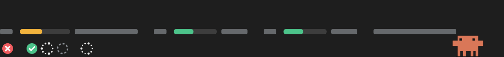<br><sub>Il chipe l'orbe</sub></p>
<p align="center">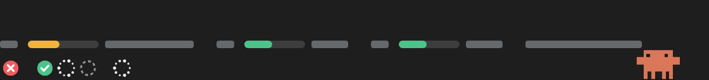<br><sub>Le pop-corn</sub></p>
<p align="center">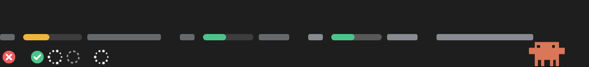<br><sub>La bousculade</sub></p>
<p align="center"><br><sub>Le petit</sub></p>
<p align="center"><br><sub>Le géant</sub></p>
<p align="center">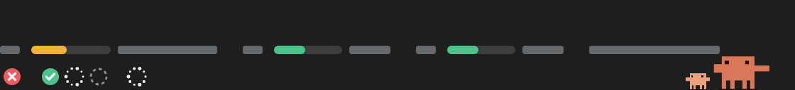<br><sub>L'équipe</sub></p>

### Et aussi

- **Survole-le** : ♥ pour le caresser (le compteur est gardé d'une session à
  l'autre), 🎲 pour qu'il change d'activité, 🕺 pour qu'il danse, ⭐ pour son
  niveau. Tes gestes passent tout de suite, avant ce qu'il fait.
- **`/clawd`** : son niveau et son humeur. `/clawd montre <numéro | bande |
  scène>` lui fait jouer un numéro ou une scène. `/clawd voit` dit ce qu'il
  voit de la bande, et pourquoi un numéro se joue ou non.
- **Rien ne se coupe** : une scène va au bout, et les réactions attendent leur
  tour. Il marche d'une scène à l'autre, sans jamais sauter. Quand l'app
  recrée son image, chaque animation reprend là où elle en était.
- **Dans le terminal** : son logo en blocs, un emoji pour ce qu'il fait, et
  un ▪ par mini, à sa couleur.

### Ce qu'il lit, ce qu'il garde

Clawd n'appelle aucun modèle, ne fait aucune requête réseau et ne lance aucun
processus. Il suit les événements de ta session : les outils lancés et leur
résultat (pour savoir si un build ou un push passe), tes messages, les
sous-agents, le compactage, les permissions. Il lit aussi ce que l'app lui donne :
le modèle qui tourne, le mode de permission, le remplissage du contexte et
les quotas, la liste des sous-agents, la bande publiée par atelier. Il garde
dans le stockage du mod son compteur de caresses, son expérience, son humeur
et quelques dates, comme ta dernière visite. Testé avec Claude Code 2.1.309.

## atelier

**Le bandeau au-dessus du prompt**

- 📱 Version déclarée, dernier APK construit et version installée sur le
  téléphone (date comprise). Bouton **Installer** quand le téléphone n'est
  pas à jour (ou que l'appli n'y est pas), et **Lancer**. La version est lue
  dans le script Gradle, `pubspec.yaml`, ou `version.properties` quand le
  script la calcule.
- 🌿 Branche, nombre de modifs, commits non poussés ou en retard, branche
  supprimée sur GitHub, alerte si la version est bumpée sans CHANGELOG. Bouton
  **Commit + push** (**Commit** seul dans un dépôt sans remote), **Pull**
  quand la branche est en retard sur GitHub, **Push** quand il reste des
  commits à pousser. Pas de raccourci clavier : une lettre tapée alors que le
  focus était resté dans la bande déclenchait le bouton.
- Jauges des quotas 5 h et 7 j et du contexte, à lire d'un coup d'œil :
  - **couleur** : vert, ambre ou rouge selon le niveau, et la barre pulse en
    critique ;
  - **petit trait** : il marque le temps écoulé dans la fenêtre. Si la barre
    le dépasse, tu consommes trop vite et la jauge vire à l'ambre avant même
    le seuil ;
  - **heure du reset** : elle s'affiche quand ça devient serré.

  Un toast t'avertit aussi à 80 % puis à 95 %. Au survol, chaque jauge dit
  sa projection : à ce rythme, 100 % vers telle heure, ou « tu tiens ».
  Quand tu vas trop vite, elle dit aussi combien de temps sans Claude pour
  revenir dans le rythme, et jusqu'à quelle heure.
- Juste après, la conso du tour en direct : ses tokens et ce qu'il coûterait
  au tarif de l'API, en euros, avec le détail et le total de la session au
  survol. Elle vire à l'ambre quand la conversation devient lourde (chaque
  réponse relit plus de 400 k tokens) : une conversation neuve coûterait
  bien moins.
- Puis le conseil de modèle : Haiku lit chaque demande que tu tapes (avec le
  projet, le plan, le build, les sous-agents et les quotas) et dit quel
  modèle et quel effort suffisent pour la suite, par exemple « 💡 Sonnet ·
  Moyen ». La puce ne s'affiche que quand ce n'est pas ce qui tourne, la
  raison au survol ; c'est toi qui changes. Quelques centaines de tokens de
  Haiku par demande. Une réponse courte (« oui », « vas-y ») garde le conseil
  d'avant ; les routines, les autres sessions, les plugins et le bandeau
  masqué n'appellent pas Haiku.
- Juste en dessous, la liste de tâches de Claude en pastilles : un rond par
  étape, en pointillé tant qu'elle attend, un anneau de points qui respire
  pendant qu'elle avance (l'orbe « breathing » de
  [thinking-orbs](https://github.com/Jakubantalik/thinking-orbs), de Jakub
  Antalik, sous licence MIT), coché en vert une fois faite. Le nom de
  l'étape s'affiche au survol, avec depuis quand elle avance ou en combien de
  temps elle s'est faite. Après un trait, les sous-agents, à la couleur de
  leur modèle (comme les mini-Clawds), avec leur mission et leur durée ; à
  chaque outil qu'un sous-agent lance, sa pastille émet une onde (le sonar).
  Cinq minutes après que tout est fini, les pastilles finies s'en vont.
- Dans la ligne 📱, le build en pastille : l'orbe pendant un `gradlew` ou un
  `flutter build` (même en tâche de fond), puis une coche avec sa durée, ou
  une croix rouge avec la tâche qui a échoué et sa première erreur au survol.
- La bande partagée, où Clawd joue ses numéros : atelier publie ce qu'il
  dessine et où (son état `atelier.scene`), donne le dessin de chaque élément
  (à l'identique, sans son infobulle), ne dessine plus ce que Clawd tient (son
  état `clawd.emprunts`, chaque emprunt avec son échéance) et pose le numéro
  par-dessus toute la bande (`clawd.grandeScene`). Atelier doit être chargé
  avant Clawd : c'est sa rangée qui couvre la bande.

**Les garde-fous sur Bash et PowerShell**

- adb et le JBR d'Android Studio sont trouvés tout seuls (Windows, macOS,
  Linux). Si une commande pointe vers un JBR d'Android Studio cassé, il est
  remplacé par celui qui marche. `JAVA_HOME` est ajouté à `gradlew` quand il
  manque.
- Commandes destructrices (`pm clear`, `uninstall`, `connectedAndroidTest`,
  push forcé, `reset --hard`…) : il faut ton accord. La commande est lue comme
  le shell la lit : chaque règle ne vise que son outil (un message de commit, un
  `grep` ou un heredoc qui citent une commande ne demandent rien), et la
  question montre la commande en cause. Ce que tu écris sous « Other » est
  transmis à Claude.
- Secrets (`local.properties`, keystore, `google-services.json`, `.env`) en
  partance dans un commit ou un push : demande de confirmation, dans le dépôt
  visé (celui du `cd` ou du `-C`). Une suppression ne compte pas.
- Option `garde_fou_ok` (désactivée par défaut, dans `/config`) : pour qui a
  son propre garde-fou global qui lit `GARDE_FOU_OK=1`.
  - Activée, une commande qui pose ce drapeau (`GARDE_FOU_OK=1 …`,
    `export GARDE_FOU_OK=1; …`, ou `$env:GARDE_FOU_OK = 1` en PowerShell)
    saute le contrôle des secrets d'atelier : ton garde-fou est censé avoir
    déjà eu ton accord. Et après ton « Autoriser », atelier ajoute le drapeau
    à la commande, pour que ton garde-fou ne te redemande pas.
  - Désactivée, atelier ignore le drapeau et ne l'ajoute jamais. Sinon,
    n'importe quelle commande pourrait le poser pour sauter ce contrôle.
  - C'est un booléen JSON : une autre valeur écrite à la main dans
    `settings.json` empêche atelier de se charger, garde-fous compris.
- Push non demandé : demande de confirmation (un commit passe sans demander).
  Seule ta demande compte, pas une notification de tâche de fond. Avec
  l'option `push_sans_demande` (désactivée par défaut, dans `/config`), il
  passe sans question ; les secrets, eux, demandent toujours.
- Refusés : `bash` lancé depuis PowerShell (sous Windows, ça ouvre WSL) et les
  attentes de 20 s ou plus au premier plan (`Start-Sleep` et `sleep`,
  additionnés, et les boucles d'attente) : mieux vaut une tâche de fond.

**Divers**

- Si Claude répond en anglais, il reçoit un rappel au tour suivant.
- `/tel` installe le dernier APK ; `/atelier` masque ou affiche le bandeau et
  donne la version. Caché avec son bouton « Masquer », le bandeau revient
  aussi avec `/atelier`.
- 🆕 sur la bande ouvre une nouvelle conversation (ta commande `/suite` si tu
  en as une, sinon `/clear`). Toujours le même, à la même place, discret.
  Quand continuer ici coûte trop, la bande partagée publie sa place, pour que
  Clawd vienne le montrer : chaque requête relit toute la conversation, et le
  dernier tour a relu au moins 4 M tokens de plus qu'une conversation neuve
  (sur un contexte d'au moins 300 k).

## Développer

```bash
claude plugin validate clawd
claude plugin test clawd
claude plugin validate atelier
claude plugin test atelier
```

Le film de présentation (`docs/index.html`, publié sur GitHub Pages), la
bande-annonce du README (`promo/bande-annonce.svg`) et la vitrine
(`promo/vitrine/`) sont générés depuis le code des mods, avec leurs vrais
sprites et leurs vraies jauges. Les GIF des numéros (`--numeros`) demandent
Edge et ffmpeg.

```bash
node --experimental-strip-types promo/genere.mts
node --experimental-strip-types promo/vitrine.mts --numeros
```

## Licence

[MIT](LICENSE). L'orbe « breathing » d'atelier vient de
[thinking-orbs](https://github.com/Jakubantalik/thinking-orbs) (MIT, Jakub
Antalik) ; sa notice est dans `atelier/hooks/orbe.ts`.
